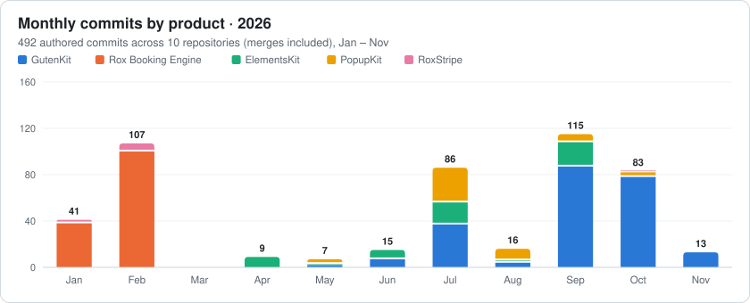
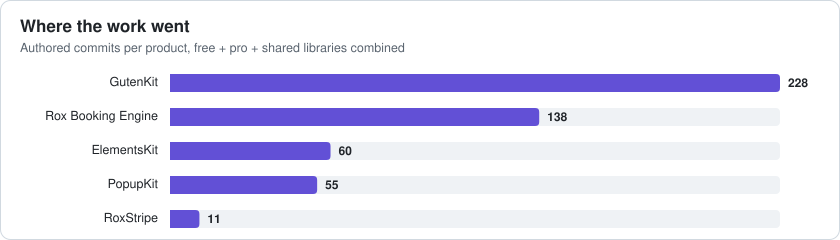

<!-- ═══════════════════════════ HEADER ═══════════════════════════ -->

  

  

  

  
  
  

<!-- ═══════════════════════════ AT A GLANCE ═══════════════════════════ -->
<table align="center">
  <tr>
    <td align="center" width="170"><h2>492</h2>authored commits in 2026</td>
    <td align="center" width="170"><h2>5</h2>products shipped to</td>
    <td align="center" width="170"><h2>10</h2>active repositories</td>
    <td align="center" width="170"><h2>1M+</h2>sites running ElementsKit</td>
  </tr>
</table>

---

## 🧭 About

I build and lead work on **WordPress products used by millions of sites**, from Gutenberg blocks and Elementor widgets to booking and payment systems.

My work sits between **engineering and research**: I dig into why the editor and the live site act differently, how block deprecations break saved content, and how to make plugins secure, accessible and translatable without slowing them down.

- 🧱 **Block engineering**: GutenKit Free and Pro, plus the shared `gkit-components` library
- 🧩 **Elementor ecosystem**: ElementsKit Pro, Lite and Essential
- 🎯 **Conversion tooling**: PopupKit dashboard, A/B testing and analytics UI
- 🗓️ **Project lead**: Rox Booking Engine (appointments, orders, payments) and RoxStripe
- 🔐 **Security mindset**: rate limiting, nonces, XSS and open-redirect hardening

 

---

## 🔬 Research & Engineering Focus

<table>
  <tr>
    <th align="left">Area</th>
    <th align="left">What I investigate</th>
    <th align="left">Applied in</th>
  </tr>
  <tr>
    <td>⚖️ <b>Editor ↔ Frontend parity</b></td>
    <td>Making the editor and the live site behave the same: icon rotation, toggles, entrance and mouse-track animations</td>
    <td>GutenKit Accordion, Advanced Tab, Mouse Track</td>
  </tr>
  <tr>
    <td>🧬 <b>Block validation & deprecation</b></td>
    <td>Recovering broken blocks after template import, safe deprecation paths, markup migrations</td>
    <td>WhatsApp, Video, Fancy Animated Text</td>
  </tr>
  <tr>
    <td>🛡️ <b>Security hardening</b></td>
    <td>Server-side rate limiting, nonce checks, payload limits, DOM XSS and open-redirect prevention</td>
    <td>GutenKit Pro Login Form</td>
  </tr>
  <tr>
    <td>🌐 <b>i18n & accessibility</b></td>
    <td>JS string translation, ordered placeholders, translator comments, Loco Translate compatibility</td>
    <td>PopupKit, ElementsKit, GutenKit Pro</td>
  </tr>
  <tr>
    <td>📱 <b>Responsive dashboards</b></td>
    <td>Tables, modals and analytics at 768px and below; skeleton loading for perceived speed</td>
    <td>PopupKit Dashboard & License</td>
  </tr>
  <tr>
    <td>💳 <b>Transactional data</b></td>
    <td>Atomic order, appointment and payment writes, cascading deletes, due-amount calculation</td>
    <td>Rox Booking Engine, RoxStripe</td>
  </tr>
</table>

---

## 🚀 Products I Build

<table>
  <tr>
    <td width="50%" valign="top">
      
      <h3> GutenKit Free · Pro · Components</h3>
      
Page-builder blocks, patterns and templates for the Gutenberg editor.

       
    </td>
    <td width="50%" valign="top">
      
      <h3> ElementsKit Pro · Lite · Essential</h3>
      
Elementor addons and templates: 100+ widgets, mega menu, header/footer builder.

       
    </td>
  </tr>
  <tr>
    <td width="50%" valign="top">
      
      <h3> PopupKit Free · Pro</h3>
      
Popup builder with gamification, multi-step popups, A/B testing and WooCommerce triggers.

       
    </td>
    <td width="50%" valign="top">
      <h3>🗓️ Rox Booking Engine Project Lead</h3>
      
Appointment booking platform: agents, schedules, customers, orders and Stripe payments over a modular REST API.

        
        
      <h3>💳 RoxStripe Project Lead</h3>
      
Stripe integration for WordPress with default and custom UIs, a shortcode form and a transaction status chart.

       
    </td>
  </tr>
</table>

---

## 📊 Contribution Analytics

  <picture>
    <source media="(prefers-color-scheme: dark)" srcset="./assets/chart-monthly-dark.svg"/>
    
  </picture>

  <picture>
    <source media="(prefers-color-scheme: dark)" srcset="./assets/chart-products-dark.svg"/>
    
  </picture>

<b>📋 Data table</b>

| Product | Repositories | Commits | Active months |
|---|---|---:|---|
| GutenKit | `gutenkit-blocks-addon`, `gutenkit-blocks-addon-pro`, `gkit-components` | 228 | May – Nov |
| Rox Booking Engine | `booking-engine` | 138 | Jan – Feb |
| ElementsKit | `elementskit`, `elementskit-lite`, `elementskit-essential` | 60 | Apr – Sep |
| PopupKit | `popup-builder-block`, `popup-builder-block-pro` | 55 | May – Oct |
| RoxStripe | `RoxStripe` | 11 | Jan – Feb, Oct |
| **Total** | **10** | **492** | |

  
  

  

  

---

## 🗺️ 2026 Roadmap Timeline

---

## 📝 Changelog by Project

 <b>GutenKit Pro</b> <code>Sep – Nov 2026</code>

 

| Date | Type | Change |
|---|---|---|
| 2026-11-09 |  | Login Form block: new alert UI, label inline editing, focus states, reset-password button gap |
| 2026-11-05 |  | Mouse Entrance: console error resolved |
| 2026-11-02 |  | Mouse Track: transform conflict with entrance animation in editor and frontend |
| 2026-10-26 |  | Fancy Animated Text: editor/frontend issues, icon-only style, deprecated markup |
| 2026-10-06 |  | Table of Contents: active item class and invalid CSS selector |
| 2026-10-04 |  | Login Form block: social login (WP Social Pro), minimal design, field icons |
| 2026-10-01 |  | Button text wrapping incorrectly inside Marquee |
| 2026-09-30 |  | WhatsApp: block recovery error on template import (direct asset URLs and deprecation) |
| 2026-09-28 |  | Login REST route: server-side rate limiting, nonce verification, payload length checks; DOM XSS and open-redirect fixes |
| 2026-09-28 |  | i18n for login validation, lockout countdown and errors; Loco Translate text domain |
| 2026-09-23 |  | Marquee: smoother scrolling; restored link clicks and text selection in clones |
| 2026-09-14 |  | Marquee: correct default direction and option labels |
| 2026-09-09 |  | Client Logo and Price Menu: image flash on load |

 <b>GutenKit (Free)</b> <code>Jun – Oct 2026</code>

 

| Date | Type | Change |
|---|---|---|
| 2026-10-20 |  | Advanced Accordion: active icon toggle mismatch between editor and frontend |
| 2026-10-11 |  | Counter: counter style and suffix controls |
| 2026-10-05 |  | Nav Menu: custom breakpoint issue |
| 2026-10-04 |  | Advanced Accordion: smooth icon rotation, no double-icon flash, editor/frontend parity |
| 2026-09-17 |  | Nav Menu: mobile overlay color control and entrance animation |
| 2026-09-13 |  | Advanced Tab: collapsible subtitle toggle and "Enable Smooth Toggle" option |
| 2026-09-10 |  | Testimonial: image flash removed |
| 2026-09-01 |  | Post Tab: frontend rendering for post types without taxonomies |
| 2026-08-25 |  | Post Tab: dynamic taxonomy discovery, multi-select taxonomy, grouped tab headers |
| 2026-07-23 |  | Block category icon replaced with the GutenKit icon |
| 2026-07-16 |  | Post Tab: custom post type support with server-side rendering |
| 2026-07-14 |  | Block validation errors and a frontend CORS failure |
| 2026-07-02 |  | Video: YouTube playback in the editor, block errors and vulnerabilities |

🧰 <b>gkit-components</b> (shared controls library) <code>Aug – Oct 2026</code>

 

| Date | Type | Change |
|---|---|---|
| 2026-10-05 |  | `GkitSlider` forwards `marks` and `renderTooltipContent` props |
| 2026-09-06 |  | AVIF image support in Background Overlay media picker |
| 2026-09-01 |  | Box Control reset button border |
| 2026-08-17 |  | Background Type layout when the Gutenberg plugin is active |

 <b>ElementsKit Pro · Lite · Essential</b> <code>Apr – Sep 2026</code>

 

| Date | Type | Change |
|---|---|---|
| 2026-09-17 |  | Essential: Widget Library with dynamic filter tabs, badges and styling controls |
| 2026-09-16 |  | Instagram: video media support, post reaction footer, profile header controls |
| 2026-09-01 |  | Login Form: JS string translation |
| 2026-08-24 |  | Behance Feed: icon color control |
| 2026-08-06 |  | Table: body cell Classic Text / WYSIWYG editor toggle |
| 2026-07-23 |  | Pinterest: logo styling and circle size control |
| 2026-07-19 |  | Data Table: next-button pagination |
| 2026-07-05 |  | Image Hover Effect: button icon rendering and icon margin control |
| 2026-06-29 |  | Lite: icons for Login and Registration widgets |
| 2026-06-22 |  | Lite: heading title control changed from text to textarea |
| 2026-06-11 |  | Comparison Table: tooltip feature |
| 2026-06-08 |  | Content Ticker: PHP deprecation |
| 2026-05-04 |  | Price Menu: image and caption design controls |
| 2026-04-20 |  | Copyright: custom site title override and typography; Gallery icon spacing controls |

 <b>PopupKit Free · Pro</b> <code>May – Oct 2026</code>

 

| Date | Type | Change |
|---|---|---|
| 2026-10-11 |  | Connect button disabled when integration fields are empty; filter dropdown z-index |
| 2026-09-08 |  | Action buttons wrapping on mobile |
| 2026-09-06 |  | A/B testing and subscriber tables and modals made responsive |
| 2026-08-31 |  | Table rows breaking on 768px tablets; modal height on small devices |
| 2026-08-18 |  | i18n: ordered placeholders, translator comments, JS translation path |
| 2026-07-27 |  | Skeleton loaders with shimmer for Settings and License pages |
| 2026-07-27 |  | Full responsive pass: header, campaigns, analytics, templates, integrations, A/B testing |
| 2026-07-07 |  | Onboarding: updated utility plugin list and order |
| 2026-05-23 |  | Removed dynamic tags via props in all text fields |

🗓️ <b>Rox Booking Engine</b> (Project Lead) <code>Jan – Feb 2026</code>

 

| Date | Type | Change |
|---|---|---|
| 2026-02-25 |  | Payment settings helpers, guards and PHPDoc across REST layer |
| 2026-02-24 |  | Order and appointments included in confirmation email; paid/unpaid statuses |
| 2026-02-23 |  | Batch appointments; transactional order, payment and appointment creation |
| 2026-02-23 |  | Order delete API with transactional cascade |
| 2026-02-22 |  | Customer due-amount calculation |
| 2026-02-19 |  | Customer login endpoint; currency-aware payment formatting |
| 2026-02-18 |  | Agent profiles: experience, social links, weekly work-day schedule |
| 2026-02-18 |  | Unified booking API; Stripe payment form sends full booking details |
| Jan 2026 |  | Booking panel, frontend customer flow, notifications, Stripe error handling |

💳 <b>RoxStripe</b> (Project Lead) <code>Jan – Feb 2026</code>

 

| Date | Type | Change |
|---|---|---|
| 2026-02-03 |  | Transaction status chart on settings page |
| 2026-02-03 |  | Strict types and refactored payment processing and API controller |
| 2026-02-03 |  | Shortcode Stripe form |
| 2026-02-01 |  | Stripe with a custom form UI |
| 2026-01-29 |  | Stripe integration with the default UI |

---

## 🧪 Engineering Principles

<table>
  <tr>
    <td align="center" width="25%">🎯 <b>Parity first</b> What you edit is what ships</td>
    <td align="center" width="25%">🛡️ <b>Secure by default</b> Validate, sanitize, rate-limit</td>
    <td align="center" width="25%">♻️ <b>Never break content</b> Deprecations over rewrites</td>
    <td align="center" width="25%">🌍 <b>Ship for everyone</b> i18n, a11y, every screen size</td>
  </tr>
</table>

---

## 🛠️ Tech Stack

  
    
  

  
  
  
  
  

---

## 🏆 Trophies

  

## 🐍 Contribution Snake

  <picture>
    <source media="(prefers-color-scheme: dark)" srcset="https://raw.githubusercontent.com/shishir-xs/shishir-xs/output/github-snake-dark.svg"/>
    <source media="(prefers-color-scheme: light)" srcset="https://raw.githubusercontent.com/shishir-xs/shishir-xs/output/github-snake.svg"/>
    
  </picture>

---

## 🤝 Connect

  
  
  

  

