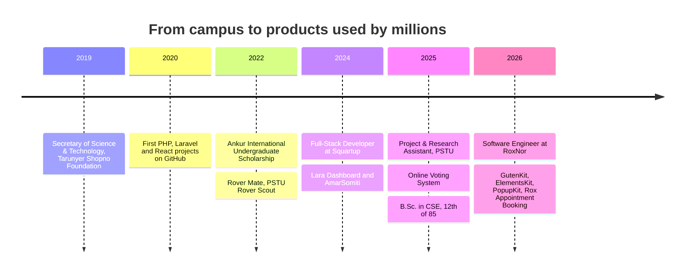
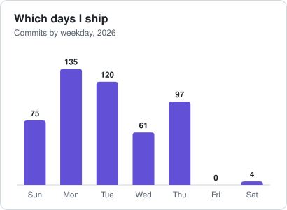
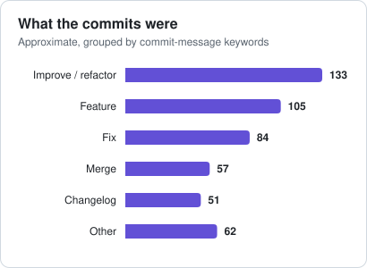
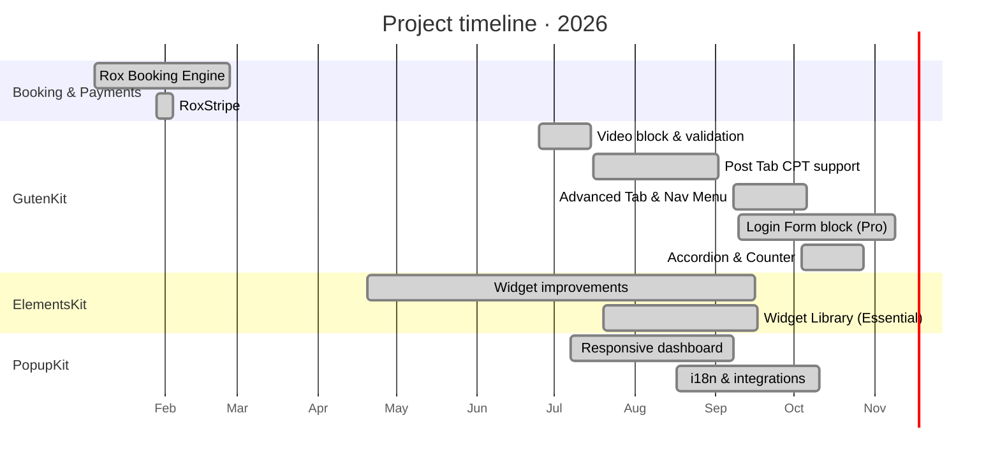

<!-- ═══════════════════════════ HEADER ═══════════════════════════ -->

  

  

  

  
  
  
  
  

<!-- ═══════════════════════════ AT A GLANCE ═══════════════════════════ -->
<table align="center">
  <tr>
    <td align="center" width="170"><h2>492</h2>authored commits in 2026</td>
    <td align="center" width="170"><h2>5</h2>products shipped to</td>
    <td align="center" width="170"><h2>10</h2>active repositories</td>
    <td align="center" width="170"><h2>1M+</h2>sites running ElementsKit</td>
  </tr>
</table>

  
  
  
  
  
  
  
  
  

---

## 🧭 About

I am a **Software Engineer at [RoxNor](https://roxnor.com)**, working with the Wpmet team on **WordPress products used by millions of sites**: Gutenberg blocks, Elementor widgets, and booking and payment systems. Before that I built Laravel platforms as a full-stack developer, and I have **4 IEEE publications** from my time at PSTU.

> 🧑‍💻 This is my work account. My personal projects and open source live at **[@engrshishir](https://github.com/engrshishir)**.

My work sits between **engineering and research**: I dig into why the editor and the live site act differently, how block deprecations break saved content, and how to make plugins secure, accessible and translatable without slowing them down.

- 🧱 **Block engineering**: GutenKit Free and Pro, plus the shared `gkit-components` library
- 🧩 **Elementor ecosystem**: ElementsKit Pro, Lite and Essential
- 🎯 **Conversion tooling**: PopupKit dashboard, A/B testing and analytics UI
- 🗓️ **Booking & payments**: Rox Booking Engine (appointments, orders, payments) and RoxStripe
- 🔐 **Security mindset**: rate limiting, nonces, XSS and open-redirect hardening

 

  

### ⚡ Currently

<table>
  <tr>
    <td width="33%" valign="top">
      <h4>🔭 Working on</h4>
      <ul>
        <li>GutenKit Pro <b>Login Form</b> block</li>
        <li>Mouse Track & entrance animation fixes</li>
        <li>Accordion and Counter controls</li>
      </ul>
    </td>
    <td width="33%" valign="top">
      <h4>🌱 Exploring</h4>
      <ul>
        <li>Block editor internals & the Interactivity API</li>
        <li>Front-end performance & asset loading</li>
        <li>Clean, SOLID plugin architecture</li>
      </ul>
    </td>
    <td width="33%" valign="top">
      <h4>💬 Ask me about</h4>
      <ul>
        <li>Block deprecations & validation errors</li>
        <li>Elementor widget controls</li>
        <li>WordPress REST API & Stripe</li>
      </ul>
    </td>
  </tr>
</table>

---

## 🧗 Journey

### 💼 Experience

<table>
  <tr>
    <td width="26%" valign="top"><b>Software Engineer</b> <a href="https://roxnor.com">RoxNor</a> Jan 2026 – Present</td>
    <td valign="top">Working with the Wpmet team on ElementsKit, GutenKit, PopupKit and Rox Appointment Booking: feature development, payment and email system setup, API design and quality assurance.</td>
  </tr>
  <tr>
    <td valign="top"><b>Full-Stack Developer</b> <a href="https://squartup.com">Squartup</a> May 2024 – Dec 2025</td>
    <td valign="top">Owned the core platform backend with SOLID, modular architecture. Built JWT authentication, organization-level data isolation with role-based permissions and database partitioning, and a premium CRM module with payments and campaign automation. Added RabbitMQ, Redis caching, Elasticsearch search, and CI/CD with GitHub Actions and Docker.</td>
  </tr>
  <tr>
    <td valign="top"><b>Project & Research Assistant</b> <a href="https://pstu.ac.bd">CCE Department, PSTU</a> Jan 2025 – Dec 2025</td>
    <td valign="top">Built and deployed web applications at the university ICT Cell, including the <a href="https://onlinevoting.pstu.ac.bd/">Online Voting System</a> used by the university community. Supported faculty and students with software, data processing and report automation.</td>
  </tr>
</table>

### 🎓 Education & Research

<table>
  <tr>
    <td width="50%" valign="top">
      <h4>🎓 B.Sc. in Computer Science and Engineering</h4>
      <a href="https://pstu.ac.bd">Patuakhali Science and Technology University</a> 
         
      Coursework: Data Structures & Algorithms, Machine Learning, Cryptography & Security, Operating Systems, Computer Architecture, Databases, Computer Networks
    </td>
    <td width="50%" valign="top">
      <h4>📄 4× IEEE Publications</h4>
          
      First author on all four: JWT security with LSTM, a metamaterial gas sensor, IoT aquaculture with federated learning, and a federated forest for drifting data. <a href="#-research-publications">See the papers ↓</a>
      <h4>🏅 Ankur International Undergraduate Scholarship</h4>
      Feb 2022 – Feb 2024 · awarded for academic project excellence and research potential.
    </td>
  </tr>
</table>

<b>🤝 Volunteering</b>

 

| Role | Organisation | When |
|---|---|---|
| Project and Technical Wing | [CSE Club, PSTU](https://cseclub.pstu.ac.bd/): events, workshops, hackathons and contests for 500+ students | Jan – Dec 2025 |
| Rover Mate | PSTU Rover Scout: built and maintained the group website, coordinated tech events | Jan 2022 – Dec 2025 |
| Secretary of Science and Technology | Tarunyer Shopno Foundation: workshops for school and college students | Jul 2019 – May 2020 |

---

## 📚 Research Publications

  
  
  

| # | Paper | Venue | Host | Topic |
|---|---|---|---|---|
| 1 | [EjwT](https://ieeexplore.ieee.org/document/11429432/) | ICECTE 2026 | Faculty of ECE, RUET | Security · Deep learning |
| 2 | [Metamaterial Absorber for Gas Detection](https://doi.org/10.1109/ICTP68765.2025.11415096) | ICTP 2025 | BUET | Metamaterials · ML |
| 3 | [MachDishari](https://ieeexplore.ieee.org/abstract/document/11502376) | RAAICON 2025 | MIST | IoT · Federated learning · XAI |
| 4 | [FTWERF](https://ieeexplore.ieee.org/document/11504106) | SPICSCON 2025 | RU | Federated learning · Concept drift |

### 🔐 1. [EjwT: Enhancing JWT Security through Dynamic Cryptographic & LSTM Networks](https://ieeexplore.ieee.org/document/11429432/)

<table>
  <tr>
    <td width="110" align="center" valign="top">
       
      Hosted by <b>Faculty of ECE, RUET</b>
    </td>
    <td valign="top">
      👥 <b>Shishir Bhuiya</b>, G. M. Shakil, Golam Md. Muradul Bashir, Md. Samsuzzaman 
      🏛️ <a href="https://icecte.ruet.ac.bd/">5th International Conference on Electrical, Computer &amp; Telecommunication Engineering (ICECTE 2026)</a>  
      A safer extension of JWT login tokens: randomised cryptography with AES-GCM encryption, plus an LSTM model that spots suspicious logins in real time.  
            
        
      
      
    </td>
  </tr>
</table>

<table align="center">
  <tr>
    <td align="center" width="25%"><b>99.60%</b> accuracy</td>
    <td align="center" width="25%"><b>97.00%</b> recall</td>
    <td align="center" width="25%"><b>96.04%</b> F1-score</td>
    <td align="center" width="25%"><b>33M+</b> auth events</td>
  </tr>
</table>

<b>▶ Show abstract</b>

 

> JSON Web Tokens (JWTs) are widely adopted as part of stateless authentication systems, but they are still vulnerable to theft of tokens, brute-force attacks, 'alg none' attack risks, and unauthorized access due to the lack of encryption and server side revocation systems. In this paper, the Extended JSON Web Token (EjwT), a safe extension of JWTs based upon dynamic cryptographic randomization, is proposed. The main elements of the proposed scheme are nonce calculation, key identifier swapping, algorithm agility, and encryption using AES-GCM, together with real-time anomaly detection performed by Long Short-Term Memory (LSTM) networks. This work trained the model with a dataset containing more than 33 million authentication events. Techniques like Interquartile Range (IQR) outlier filtering, SMOTE to handle class imbalance, and Pearson Correlation Coefficient driven feature selection are also employed. And with empirical validation, a 99.60% accuracy rate, 95.10% precision, 97.00% recall rate, and 96.04% F1-score are achieved, clearly offering a great step forward from traditional JWTs with regard to integrity, confidentiality, revocation, and resilience to brute force attacks with multi-layered risk-based authentication.

<b>📸 Conference gallery</b>

 

  
  
  
  
  
  
  

### 📡 2. [Machine Learning-Enhanced Polarization Insensitive Metamaterial Absorber for Hazardous Gas Detection](https://doi.org/10.1109/ICTP68765.2025.11415096)

<table>
  <tr>
    <td width="110" align="center" valign="top">
       
      Hosted by <b>BUET</b>
    </td>
    <td valign="top">
      👥 <b>Shishir Bhuiya</b>, Shadia Islam Ankur 
      🏛️ <a href="https://ieee-ictp.buet.ac.bd/">6th IEEE International Conference on Telecommunications and Photonics (ICTP) 2025</a> · December 18-19, 2025  
      A terahertz metamaterial absorber for detecting hazardous gases, with a KNN model that predicts its performance and cuts simulation time.  
           
        
      
      
    </td>
  </tr>
</table>

<table align="center">
  <tr>
    <td align="center" width="25%"><b>99.96%</b> absorptivity</td>
    <td align="center" width="25%"><b>0.89 THz</b> resonance</td>
    <td align="center" width="25%"><b>0.9993</b> adjusted R²</td>
    <td align="center" width="25%"><b>85%</b> less simulation time</td>
  </tr>
</table>

<b>▶ Show abstract</b>

 

> Metamaterials are synthetically engineered materials that reflect unique properties attributable to their geometric configuration. The conventional design of MMA is a complex process that necessitates the utilization of computationally demanding full-wave simulators. This research presents a THz metamaterial absorber (MMA) comprising a metallic resonant patch situated above a metallic ground plane, with an FR-4 dielectric substrate in between them. The MMA achieves a sharp resonant peak, a Q-factor of 23, and an absorptivity of 99.96% at 0.89 THz, with a sensitivity of 1.59(905GHz/RIU). At the minimum working frequency, the proposed design is thin (0.027λ) and compact (0.38λ). The KNN regressor attains an RMSE of 0.4576, an adjusted R2 value of 0.9993 for optimal absorptivity prediction, and yields an 85% reduction in simulation duration. It is suitable for electromagnetic interference shielding, stealth, and sensing applications, ensuring reliable performance across diverse environments.

<b>📸 Conference gallery</b>

 

  
  
  
  
  
  
  

### 🐟 3. [MachDishari: IoT- Enabled Aquaculture Using Federated Machine Learning and XAI](https://ieeexplore.ieee.org/abstract/document/11502376)

<table>
  <tr>
    <td width="110" align="center" valign="top">
       
      Hosted by <b>MIST</b>
    </td>
    <td valign="top">
      👥 <b>Shishir Bhuiya</b>, Md Mohibullah Hawlader 
      🏛️ <a href="https://raaicon.org/2025/">4th IEEE International Conference on Robotics, Automation, Artificial-intelligence and Internet-of-Things</a>  
      IoT sensors watch pond water quality and a machine-learning model recommends which fish species to farm, trained with federated learning so farm data stays private.  
             
        
      
      
    </td>
  </tr>
</table>

<table align="center">
  <tr>
    <td align="center" width="25%"><b>99.8%</b> accuracy</td>
    <td align="center" width="25%"><b>8</b> water parameters</td>
    <td align="center" width="25%"><b>XGBoost</b> best model</td>
    <td align="center" width="25%"><b>FL + XAI</b> private and explainable</td>
  </tr>
</table>

<b>▶ Show abstract</b>

 

> The integration of innovative technologies such as the Internet of Things (IoT) and Machine Learning (ML) presents a transformative approach to enhancing traditional fish farming practices. Conventional fish farming often faces challenges due to high labor costs, unmonitored water quality monitoring changes, fish disease outbreaks, and recommendation of optimal fish species. In this paper, present MachDishari system that is IoT based ML recommendation system designed to automate water quality monitoring and suggests appropriate fish species based on various water quality parameters —including pH, temperature, TDS, water level, DO, BOD, COD and turbidity. We developed IoT sensors for real time data collection of water parameters, and machine learning algorithms including Random Forest (RF), Support Vector Machine (SVM), K-Nearest Neighbor (KNN) and Logistic Regression (LR) were applied to the pond water real-time dataset. Federated Learning (FL) into our design integrate for sensitive data privacy and train machine learning models collaboratively without centralizing sensitive data. This approach preserves data privacy and enables farms in remote areas to collaboratively improve model performance without risking data leakage. A range of XAI methods was applied in the present study to enhance the interpretability and transparency of fish recommendation. Among tested models XGBoost that achieved the best performance, delivering 99.8% accuracy was deployed in a web interface and app, enabling farmers to receive real time water quality assessments and fish species recommendations and then expected to enhance fish yield for modern aquaculture with preserving data privacy.

### 🌲 4. [FTWERF: A Federated Temporal Weighted Self Evolving Forest Framework Under Concept Drift](https://ieeexplore.ieee.org/document/11504106)

<table>
  <tr>
    <td width="110" align="center" valign="top">
       
      Hosted by <b>RU</b>
    </td>
    <td valign="top">
      👥 <b>Shishir Bhuiya</b> 
      🏛️ <a href="https://spicscon.org/2025/">International Conference on Signal Processing, Information, Communication and Systems 2025</a>  
      A Random Forest that keeps up with data that changes over time: it weights recent data more, reshapes its own trees, and trains across devices without sharing raw data.  
             
        
      
      
    </td>
  </tr>
</table>

<table align="center">
  <tr>
    <td align="center" width="25%"><b>Sole</b> author</td>
    <td align="center" width="25%"><b>Federated</b> no raw data shared</td>
    <td align="center" width="25%"><b>Adaptive</b> time-weighted window</td>
    <td align="center" width="25%"><b>Self-evolving</b> tree structure</td>
  </tr>
</table>

<b>▶ Show abstract</b>

 

> Random Forests were traditionally not effective in dealing with changing data streams that have concept drift since they are not typically knowledge management over time. It is the issue of concept drift that appears because of the time dependent changes in the distribution of data. In response to this, the FTWERF suggests the use of the temporally weighted layer to prioritize the more recent data and allow the responsiveness to the newly created patterns. Besides, self evolving strategy and the alteration of the architecture is used by TWERF to guarantee that data is used optimally as the dynamics change. This flexibility is very essential in proper reflection or representation of dynamic systems. This is why it is a good candidate for Federated Learning, a process of training a model over a large number of devices while keeping all the devices synchronized without necessarily storing raw data on a central computer. By gathering these three aspects, the safety is enhanced, memory footprints are minimized, and the processes go on faster. Experimentally We verify FTWERF by proving it is significantly better than simple Random Forests and even competing with the state-of-the-art algorithms. One of the areas that FTWERF is able to handle is temporal data as shown by these results. Such adaptability and adjustment of the structure make it a sound and speedy solution to adapt to the changes of the real-world issues which provide unceasing changes of data streams. FTWERF is advantageous as it is a temporal environment that is training free and provides a great and corrective predictive model of dynamic data-affine tasks. In more specific terms, the temporal weighting is based on an adaptive window in order to give more priority to data that is more relevant to the current detection, and the part that is self evolving is the one that further produces the tree structure and feature selection in a manner that is understandable to evolutionary biology.

---

## 🔬 Research & Engineering Focus

<table>
  <tr>
    <th align="left">Area</th>
    <th align="left">What I investigate</th>
    <th align="left">Applied in</th>
  </tr>
  <tr>
    <td>⚖️ <b>Editor ↔ Frontend parity</b></td>
    <td>Making the editor and the live site behave the same: icon rotation, toggles, entrance and mouse-track animations</td>
    <td>GutenKit Accordion, Advanced Tab, Mouse Track</td>
  </tr>
  <tr>
    <td>🧬 <b>Block validation & deprecation</b></td>
    <td>Recovering broken blocks after template import, safe deprecation paths, markup migrations</td>
    <td>WhatsApp, Video, Fancy Animated Text</td>
  </tr>
  <tr>
    <td>🛡️ <b>Security hardening</b></td>
    <td>Server-side rate limiting, nonce checks, payload limits, DOM XSS and open-redirect prevention</td>
    <td>GutenKit Pro Login Form</td>
  </tr>
  <tr>
    <td>🌐 <b>i18n & accessibility</b></td>
    <td>JS string translation, ordered placeholders, translator comments, Loco Translate compatibility</td>
    <td>PopupKit, ElementsKit, GutenKit Pro</td>
  </tr>
  <tr>
    <td>📱 <b>Responsive dashboards</b></td>
    <td>Tables, modals and analytics at 768px and below; skeleton loading for perceived speed</td>
    <td>PopupKit Dashboard & License</td>
  </tr>
  <tr>
    <td>💳 <b>Transactional data</b></td>
    <td>Atomic order, appointment and payment writes, cascading deletes, due-amount calculation</td>
    <td>Rox Booking Engine, RoxStripe</td>
  </tr>
</table>

---

## 🚀 Products I Build

<table>
  <tr>
    <td width="50%" valign="top">
      
      <h3> GutenKit Free · Pro · Components</h3>
      
Page-builder blocks, patterns and templates for the Gutenberg editor.

       
    </td>
    <td width="50%" valign="top">
      
      <h3> ElementsKit Pro · Lite · Essential</h3>
      
Elementor addons and templates: 100+ widgets, mega menu, header/footer builder.

      My widgets and tools: TikTok Feed, Circle Menu, Hotspot, Protected Content, Iconpack Generator, advanced popup search.  
       
    </td>
  </tr>
  <tr>
    <td width="50%" valign="top">
      
      <h3> PopupKit Free · Pro</h3>
      
Popup builder with gamification, multi-step popups, A/B testing and WooCommerce triggers.

       
    </td>
    <td width="50%" valign="top">
      <h3>🗓️ <a href="https://wordpress.org/plugins/rox-appointment-bookings/">Rox Appointment Booking</a></h3>
      
Appointment booking plugin: agents, schedules, customers, orders and Stripe payments (pay-later and deposits) over a REST API with role-based access, custom email gateways and UTC-normalised times.

        
        
      <h3>💳 RoxStripe</h3>
      
Stripe integration for WordPress with default and custom UIs, a shortcode form and a transaction status chart.

       
    </td>
  </tr>
</table>

---

## 📊 Contribution Analytics

  <picture>
    <source media="(prefers-color-scheme: dark)" srcset="./assets/chart-monthly-dark.svg"/>
    
  </picture>

  <picture>
    <source media="(prefers-color-scheme: dark)" srcset="./assets/chart-products-dark.svg"/>
    
  </picture>

<b>📋 Data table</b>

| Product | Repositories | Commits | Active months |
|---|---|---:|---|
| GutenKit | `gutenkit-blocks-addon`, `gutenkit-blocks-addon-pro`, `gkit-components` | 228 | May – Nov |
| Rox Booking Engine | `booking-engine` | 138 | Jan – Feb |
| ElementsKit | `elementskit`, `elementskit-lite`, `elementskit-essential` | 60 | Apr – Sep |
| PopupKit | `popup-builder-block`, `popup-builder-block-pro` | 55 | May – Oct |
| RoxStripe | `RoxStripe` | 11 | Jan – Feb, Oct |
| **Total** | **10** | **492** | |

  <picture>
    <source media="(prefers-color-scheme: dark)" srcset="./assets/chart-weekday-dark.svg"/>
    
  </picture>
  <picture>
    <source media="(prefers-color-scheme: dark)" srcset="./assets/chart-types-dark.svg"/>
    
  </picture>

### 🎲 Fun Facts From My Commit History

<table align="center">
  <tr>
    <td align="center" width="25%">🔥 <b>25 commits</b> busiest day 27 Jul 2026</td>
    <td align="center" width="25%">📅 <b>Monday</b> favourite day 135 commits</td>
    <td align="center" width="25%">🏖️ <b>0 on Fridays</b> weekends are for recharging</td>
    <td align="center" width="25%">⚙️ <b>88 active days</b> about 5.6 commits per active day</td>
  </tr>
</table>

  
  

  

  

### 🕐 When I code

  
  

---

## 🗺️ 2026 Roadmap Timeline

---

## 🌍 Open Source & Personal Projects

<table>
  <tr>
    <td width="96" align="center" valign="top">
      
    </td>
    <td valign="top">
      <b><a href="https://github.com/engrshishir">@engrshishir</a></b> · my personal GitHub since 2020 · <i>"Code never lie"</i> 
      
      
      
       
      
      
      
    </td>
  </tr>
</table>

  
  

### ⚡ Featured: Lara Dashboard

  

  
  
  
  
  

**[Lara Dashboard](https://laradashboard.com/)** is a free, open-source CMS and admin platform for Laravel. One codebase gives you users, roles and permissions, a blog and page CMS, media, email, translations and a module marketplace, so you can build a SaaS app, CRM, store or internal tool without months of boilerplate. It also has a built-in MCP server, so AI agents like Claude and Cursor can run the site with the same permissions as the person who connects them.

I contributed to it while at Squartup: the modular architecture, JWT authentication, organization-level data isolation, the premium CRM module, RabbitMQ, Redis and Elasticsearch.

<table>
  <tr>
    <td align="center" width="25%"><h3>50+</h3>built-in features</td>
    <td align="center" width="25%"><h3>50+</h3>MCP tools for AI agents</td>
    <td align="center" width="25%"><h3>56+</h3>API endpoints</td>
    <td align="center" width="25%"><h3>30+</h3>languages</td>
  </tr>
</table>

#### 🎬 Watch

<table>
  <tr>
    <td width="50%" align="center" valign="top">
      
       <b>▶ Lara Dashboard in 60 seconds</b> A quick tour of the dashboard, CMS, roles, modules and the MCP server.
    </td>
    <td width="50%" align="center" valign="top">
      
       <b>▶ Connect Claude with MCP (5 min)</b> Setup, then a real session: daily briefing, replying to a lead, publishing a post.
    </td>
  </tr>
</table>

<b>🧩 What's inside</b>

 

| Feature | What it does |
|---|---|
| 🤖 Agentic AI | Describe a task in plain language; generate posts, SEO metadata and images (OpenAI, Claude, Gemini, Ollama) |
| 🧱 Visual page builder | Drag and drop with 26+ blocks, undo/redo, and email-safe HTML |
| 📦 Module system | Install modules from a ZIP, enable or disable them, or get them from the marketplace |
| 📝 Content management | Posts, pages, categories, scheduling, revisions and built-in SEO |
| 👥 Users | Profiles, activity log, impersonation, bulk actions and exports |
| 🔐 Roles & permissions | 5 default roles, custom roles and "edit own" permissions |
| 🌐 Translations | 30+ languages, right-to-left support and safe overrides |
| 🛠️ Stack | Laravel 13, Livewire, Tailwind CSS 4, Alpine.js, React, Inertia.js, PHP 8.3+ |

  

### 🗂️ More projects

<table>
  <tr>
    <td width="50%" valign="top">
      <h4>🤖 <a href="https://github.com/engrshishir/Chatbot-Python-Js">PSTU Dialogue</a></h4>
        
      A chatbot for quick answers on PSTU academic programs, admissions, campus details and events.
    </td>
    <td width="50%" valign="top">
      <h4>🏦 <a href="https://amarsomiti.com/">AmarSomiti</a></h4>
         
      Cooperative financial management system: DPS, FDR, savings, shares and loans, with SSLCommerz payments, bulk SMS, transaction integrity and RabbitMQ for background jobs.
    </td>
  </tr>
  <tr>
    <td width="50%" valign="top">
      <h4>🧰 <a href="https://github.com/engrshishir/larainitializer">larainitializer</a></h4>
      A Laravel package that sets up the basics of a new project so you can start building faster.
      <h4>🔎 <a href="https://github.com/engrshishir/laravel-app-info">laravel-app-info</a></h4>
      A Laravel package for quick insights into your application.
      <h4>🏛️ <a href="https://github.com/engrshishir/larasolidarc">larasolidarc</a></h4>
      SOLID architecture for Laravel applications.
    </td>
    <td width="50%" valign="top">
      <h4>🐍 </h4>
      A Python package for managing GitHub repositories from Google Colab or locally: token auth, create, clone and everyday git actions.
      <h4>📘 <a href="https://github.com/engrshishir/Django-Portfolio">Django step-by-step</a></h4>
      A learning repository that walks through Django one step at a time.
    </td>
  </tr>
</table>

<b>📦 More from my personal account</b>

 

| Project | What it is | Stack |
|---|---|---|
| [Online Voting System](https://onlinevoting.pstu.ac.bd/) | Voting platform used by the PSTU community | Web |
| [bangla-dua](https://github.com/engrshishir/bangla-dua) | Bangla dua data for a Chrome extension | Data |
| [Laravel-Exam-Management-System](https://github.com/engrshishir/Laravel-Exam-Management-System) | Exam management project | Laravel, Blade |
| [Registration, login and password reset with email verification](https://github.com/engrshishir/Registration-Login-Forgot-Password-System-With-Email-Verification-Link-using--PHP-) | Full auth flow in plain PHP | PHP |
| [Lumen-Api-Instruction-2021](https://github.com/engrshishir/Lumen-Api-Instruction-2021) | Lumen API guide | PHP, Lumen |
| [Laravel-React-Api-Task-Management-2020](https://github.com/engrshishir/Laravel-React-Api-Task-Management-2020) | Task manager with a Laravel API and React front-end | Laravel, React |
| [University-Management-System](https://github.com/engrshishir/University-Management-System) | University management app | Java |
| [SHISHIR-CSE-PSTU](https://github.com/engrshishir/SHISHIR-CSE-PSTU) | Lecture notes, assignments and code samples for CSE students | Notes |
| [Simulation](https://github.com/engrshishir/Simulation) | Simulation notebooks | Jupyter |
| Laravel how-tos | [Ajax CRUD](https://github.com/engrshishir/Laravel-Ajax-Crud), [form validation](https://github.com/engrshishir/Laravel-Form-validation), [image CRUD](https://github.com/engrshishir/Laravel-Image-Crud-Operation), [social login](https://github.com/engrshishir/Laravel-Social-Login), [mailing](https://github.com/engrshishir/Laravel-Mailing) | Laravel |
| React and Node practice | [Redux book app](https://github.com/engrshishir/Redux-Book-App), [React CRUD](https://github.com/engrshishir/React-Crud), [Node.js MySQL CRUD](https://github.com/engrshishir/Nodejs-Mysql-Crud) | React, Node.js |

---

## 🌟 Highlights

<table>
  <tr>
    <td width="50%" valign="top">
      <h4>🔐 Login Form block GutenKit Pro</h4>
      A full login, registration and reset-password block with social login, built with rate limiting, nonce checks and XSS protection from the start.
    </td>
    <td width="50%" valign="top">
      <h4>🗂️ Post Tab with custom post types GutenKit</h4>
      Post Tab now works with any post type and taxonomy, rendered on the server with dynamic tab headers.
    </td>
  </tr>
  <tr>
    <td width="50%" valign="top">
      <h4>📱 Fully responsive dashboard PopupKit</h4>
      Every admin screen (campaigns, analytics, A/B testing, subscribers, settings) reworked for tablet and mobile, with skeleton loaders.
    </td>
    <td width="50%" valign="top">
      <h4>📚 Widget Library ElementsKit Essential</h4>
      A widget that lists every ElementsKit widget and module, with filter tabs and badges generated from the live widget list.
    </td>
  </tr>
  <tr>
    <td width="50%" valign="top">
      <h4>📸 Instagram feed upgrade ElementsKit</h4>
      Video posts, a reaction footer and profile header controls for the Instagram widget.
    </td>
    <td width="50%" valign="top">
      <h4>🗓️ Booking and payment flow Rox Booking Engine</h4>
      Orders, appointments and Stripe payments saved together in one transaction, with batch bookings and confirmation emails.
    </td>
  </tr>
</table>

---

## 📝 Changelog by Project

 <b>GutenKit Pro</b> <code>Sep – Nov 2026</code>

 

| Date | Type | Change |
|---|---|---|
| 2026-11-09 |  | Login Form block: new alert UI, label inline editing, focus states, reset-password button gap |
| 2026-11-05 |  | Mouse Entrance: console error resolved |
| 2026-11-02 |  | Mouse Track: transform conflict with entrance animation in editor and frontend |
| 2026-10-26 |  | Fancy Animated Text: editor/frontend issues, icon-only style, deprecated markup |
| 2026-10-06 |  | Table of Contents: active item class and invalid CSS selector |
| 2026-10-04 |  | Login Form block: social login (WP Social Pro), minimal design, field icons |
| 2026-10-01 |  | Button text wrapping incorrectly inside Marquee |
| 2026-09-30 |  | WhatsApp: block recovery error on template import (direct asset URLs and deprecation) |
| 2026-09-28 |  | Login REST route: server-side rate limiting, nonce verification, payload length checks; DOM XSS and open-redirect fixes |
| 2026-09-28 |  | i18n for login validation, lockout countdown and errors; Loco Translate text domain |
| 2026-09-23 |  | Marquee: smoother scrolling; restored link clicks and text selection in clones |
| 2026-09-14 |  | Marquee: correct default direction and option labels |
| 2026-09-09 |  | Client Logo and Price Menu: image flash on load |

 <b>GutenKit (Free)</b> <code>Jun – Oct 2026</code>

 

| Date | Type | Change |
|---|---|---|
| 2026-10-20 |  | Advanced Accordion: active icon toggle mismatch between editor and frontend |
| 2026-10-11 |  | Counter: counter style and suffix controls |
| 2026-10-05 |  | Nav Menu: custom breakpoint issue |
| 2026-10-04 |  | Advanced Accordion: smooth icon rotation, no double-icon flash, editor/frontend parity |
| 2026-09-17 |  | Nav Menu: mobile overlay color control and entrance animation |
| 2026-09-13 |  | Advanced Tab: collapsible subtitle toggle and "Enable Smooth Toggle" option |
| 2026-09-10 |  | Testimonial: image flash removed |
| 2026-09-01 |  | Post Tab: frontend rendering for post types without taxonomies |
| 2026-08-25 |  | Post Tab: dynamic taxonomy discovery, multi-select taxonomy, grouped tab headers |
| 2026-07-23 |  | Block category icon replaced with the GutenKit icon |
| 2026-07-16 |  | Post Tab: custom post type support with server-side rendering |
| 2026-07-14 |  | Block validation errors and a frontend CORS failure |
| 2026-07-02 |  | Video: YouTube playback in the editor, block errors and vulnerabilities |

🧰 <b>gkit-components</b> (shared controls library) <code>Aug – Oct 2026</code>

 

| Date | Type | Change |
|---|---|---|
| 2026-10-05 |  | `GkitSlider` forwards `marks` and `renderTooltipContent` props |
| 2026-09-06 |  | AVIF image support in Background Overlay media picker |
| 2026-09-01 |  | Box Control reset button border |
| 2026-08-17 |  | Background Type layout when the Gutenberg plugin is active |

 <b>ElementsKit Pro · Lite · Essential</b> <code>Apr – Sep 2026</code>

 

| Date | Type | Change |
|---|---|---|
| 2026-09-17 |  | Essential: Widget Library with dynamic filter tabs, badges and styling controls |
| 2026-09-16 |  | Instagram: video media support, post reaction footer, profile header controls |
| 2026-09-01 |  | Login Form: JS string translation |
| 2026-08-24 |  | Behance Feed: icon color control |
| 2026-08-06 |  | Table: body cell Classic Text / WYSIWYG editor toggle |
| 2026-07-23 |  | Pinterest: logo styling and circle size control |
| 2026-07-19 |  | Data Table: next-button pagination |
| 2026-07-05 |  | Image Hover Effect: button icon rendering and icon margin control |
| 2026-06-29 |  | Lite: icons for Login and Registration widgets |
| 2026-06-22 |  | Lite: heading title control changed from text to textarea |
| 2026-06-11 |  | Comparison Table: tooltip feature |
| 2026-06-08 |  | Content Ticker: PHP deprecation |
| 2026-05-04 |  | Price Menu: image and caption design controls |
| 2026-04-20 |  | Copyright: custom site title override and typography; Gallery icon spacing controls |

 <b>PopupKit Free · Pro</b> <code>May – Oct 2026</code>

 

| Date | Type | Change |
|---|---|---|
| 2026-10-11 |  | Connect button disabled when integration fields are empty; filter dropdown z-index |
| 2026-09-08 |  | Action buttons wrapping on mobile |
| 2026-09-06 |  | A/B testing and subscriber tables and modals made responsive |
| 2026-08-31 |  | Table rows breaking on 768px tablets; modal height on small devices |
| 2026-08-18 |  | i18n: ordered placeholders, translator comments, JS translation path |
| 2026-07-27 |  | Skeleton loaders with shimmer for Settings and License pages |
| 2026-07-27 |  | Full responsive pass: header, campaigns, analytics, templates, integrations, A/B testing |
| 2026-07-07 |  | Onboarding: updated utility plugin list and order |
| 2026-05-23 |  | Removed dynamic tags via props in all text fields |

🗓️ <b>Rox Booking Engine</b> <code>Jan – Feb 2026</code>

 

| Date | Type | Change |
|---|---|---|
| 2026-02-25 |  | Payment settings helpers, guards and PHPDoc across REST layer |
| 2026-02-24 |  | Order and appointments included in confirmation email; paid/unpaid statuses |
| 2026-02-23 |  | Batch appointments; transactional order, payment and appointment creation |
| 2026-02-23 |  | Order delete API with transactional cascade |
| 2026-02-22 |  | Customer due-amount calculation |
| 2026-02-19 |  | Customer login endpoint; currency-aware payment formatting |
| 2026-02-18 |  | Agent profiles: experience, social links, weekly work-day schedule |
| 2026-02-18 |  | Unified booking API; Stripe payment form sends full booking details |
| Jan 2026 |  | Booking panel, frontend customer flow, notifications, Stripe error handling |

💳 <b>RoxStripe</b> <code>Jan – Feb 2026</code>

 

| Date | Type | Change |
|---|---|---|
| 2026-02-03 |  | Transaction status chart on settings page |
| 2026-02-03 |  | Strict types and refactored payment processing and API controller |
| 2026-02-03 |  | Shortcode Stripe form |
| 2026-02-01 |  | Stripe with a custom form UI |
| 2026-01-29 |  | Stripe integration with the default UI |

---

## 🧪 Engineering Principles

<table>
  <tr>
    <td align="center" width="25%">🎯 <b>Parity first</b> What you edit is what ships</td>
    <td align="center" width="25%">🛡️ <b>Secure by default</b> Validate, sanitize, rate-limit</td>
    <td align="center" width="25%">♻️ <b>Never break content</b> Deprecations over rewrites</td>
    <td align="center" width="25%">🌍 <b>Ship for everyone</b> i18n, a11y, every screen size</td>
  </tr>
</table>

---

## 🛠️ Tech Stack

  
    
  
    
  

  
  
  
  
  

---

## 🏆 Trophies

  

## 🐍 Contribution Snake

  <picture>
    <source media="(prefers-color-scheme: dark)" srcset="https://raw.githubusercontent.com/shishir-xs/shishir-xs/output/github-snake-dark.svg"/>
    <source media="(prefers-color-scheme: light)" srcset="https://raw.githubusercontent.com/shishir-xs/shishir-xs/output/github-snake.svg"/>
    
  </picture>

---

## 💡 Dev Quote & a Laugh

  

  

---

## 🤝 Connect

  
  
  
  
  
  

  💜 Thanks for visiting. Charts and changelogs are built from real commit history.

  

